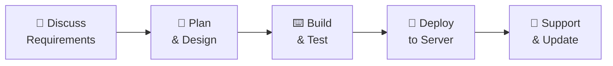

<!-- ═══════════════════════ HEADER ═══════════════════════ -->
<div align="center">


<a href="https://github.com/Ravs-Dev">
  
</a>

<br/>


</div>

<br/>

---

## 👋 About Me

I'm **Rio Revan (Muhammad-Fakrurazi)**, a developer who specializes in **web servers** and the **backend systems** that keep them running. I build complete, working systems: from the database design and API logic to the in-game features players actually touch.

> **Principle:** build it clean, make it scalable, and ship something you can maintain.

<br/>

## 🧩 What I Can Build For You

<table>
<tr>
<td width="50%" valign="top">

---

### 🎮 Game Server Development
- Game systems: account, character, vehicle, inventory, job, faction, business
- Database integration & data persistence

</td>
<td width="50%" valign="top">

### ⚙️ Backend & Database
- REST API & authentication
- Server logic and architecture
- **MySQL** schema design & optimization
- Node.js / PHP / Python services

</td>
</tr>
<tr>
<td width="50%" valign="top">

### 🌐 Web Applications
- UCP (User Control Panel) for game servers
- Admin dashboards
- Responsive landing pages & web tools
- HTML, CSS, JavaScript, PHP

</td>
<td width="50%" valign="top">

### 📱 Android Development
- Android game client & launcher
- In-app download, extraction & update system
- Built with Android Studio (Java)

</td>
</tr>
</table>

<br/>

## 🛠️ Tech Stack

<div align="center">

**Languages**


<br/>
<sub>+ Pawn (open.mp)</sub>

<br/><br/>

**Backend · Web · Database**


<br/><br/>

**Mobile · Server · Tools**


</div>

<br/>

## 🔄 How I Work



| Step | What You Get |
|---|---|
| **1. Discuss** | Clear scope, timeline, and price before any code is written |
| **2. Plan** | Feature list and database structure agreed with you |
| **3. Build** | Clean, commented, maintainable code with progress updates |
| **4. Deploy** | Setup on your Linux / VPS server |
| **5. Support** | Bug fixes and adjustments after delivery |

<br/>

## 🎯 Currently Working On

- 🔨 Android game client architecture
- 🔨 Backend, API & database systems
- 📚 Always learning: *build, learn, improve, repeat*

<br/>

---

## ⟨ DEVELOPMENT NETWORK :: SPECIALIZATION ⟩

```text
DEVELOPMENT NETWORK
│
├── PROGRAMMING
│   ├─ C
│   ├─ C++
│   ├─ PAWN
│   ├─ Python
│   ├─ Java
│   ├─ JavaScript
│   └─ PHP
│
├── GAME SYSTEMS
│   ├─ SA-MP
│   ├─ open.mp
│   ├─ Gamemode
│   ├─ Account Systems
│   ├─ Vehicle Systems
│   ├─ Inventory Systems
│   └─ Database Integration
│
├── BACKEND
│   ├─ Node.js
│   ├─ PHP
│   ├─ MySQL
│   ├─ REST API
│   └─ Authentication
│
├── WEB
│   ├─ HTML
│   ├─ CSS
│   ├─ JavaScript
│   └─ Dashboard
│
├── MOBILE
│   ├─ Android Studio
│   ├─ Java
│   └─ Android Client
│
└── SERVER
    ├─ Linux
    ├─ VPS
    ├─ Bash
    ├─ Git
    └─ Deployment
```

---

## 🤝 Let's Work Together

Have a project in mind? Send me a message with your idea, budget, and deadline and I'll reply with a clear plan.

<div align="center">

<a href="https://wa.me/62XXXXXXXXXXX"></a>
<a href="https://discord.com/users/YOUR_DISCORD_ID"></a>
<a href="mailto:youremail@example.com"></a>
<a href="https://t.me/YOUR_USERNAME"></a>

</div>

<br/>

<div align="center">


<sub>⭐ If you like my work, feel free to follow or star a repository.</sub>

</div>
